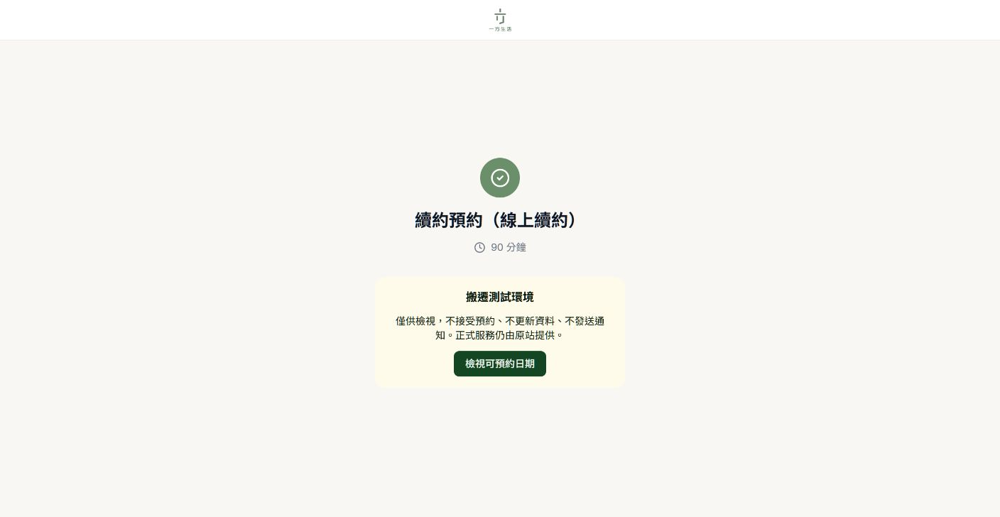
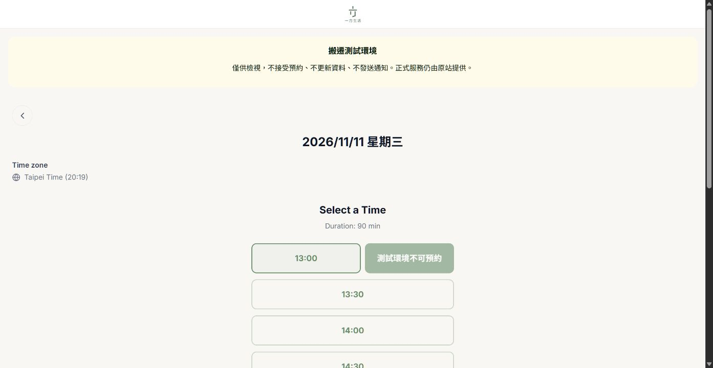

# ONE-817 續約／退租預約 GCP 試搬

追蹤：[ONE-817](https://oneplace-tw.atlassian.net/browse/ONE-817)。本次只試搬預約系統，不代表工單其他服務已完成。

## 範圍與界線

- 使用者批准本機執行，先在 dev-vm 試搬。舊 Zeabur 網站、正式網域、LINE LIFF、排程與通知設定維持原狀。
- 程式以 `origin/main` 的 `d31659afbb77cc844503339db949470a2630d4f6` 為基準，保留 ONE-798 與 ONE-818 現有流程。
- 新站只提供範本及日曆時段預覽。租客驗證、匯訂、建單、改期、取消、回饋、Ragic 更新、日曆寫入與通知都不開放。
- 沒有資料庫 migration、資料搬移或 IAM／防火牆／DNS 修改。正式切換須另由可信確認。

## 隔離機制

1. `BOOKING_MIGRATION_TRIAL=true` 與 `BOOKING_WRITES_ENABLED=false`。啟動檢查拒絕不一致設定或通知／Ragic／後台密鑰。
2. HTTP 入口先阻擋所有非公開靜態路徑及非 tRPC API，包含會寫入資料的 GET `/f/:id`。
3. tRPC 只允許四個明列的查詢；所有 mutation、後台查詢與日後新增的未知路由預設拒絕。
4. 新站使用相同 Supabase 專用角色，但只在新站改用 session pooler 5432；禁止使用 transaction pooler 6543。每條新連線先設定 session READ ONLY 並回讀確認，失敗就拒絕借出。沒有變更正式角色權限或全域設定。
5. 日曆 OAuth 僅要求 `calendar.readonly`；新環境不帶 Ragic、LINE、通知、後台或 outreach 資料庫憑證。
6. 前端跳過 LINE 登入及自動租客驗證，日期／時段仍沿用原元件，送出按鈕停用。CSP `connect-src 'self'` 另外阻擋前端直接呼叫匯訂服務與 LINE。
7. Docker 非 root、唯讀 rootfs、1 CPU／1 GiB／128 PID 上限、移除 capabilities，只綁 VM 的 `127.0.0.1` 隨機埠，透過 IAP 本機轉送檢視。

Supabase 連線模式依據：[官方 session／transaction 說明](https://supabase.com/kb/troubleshooting/supavisor-and-connection-terminology-explained-9pr_ZO)。

## 工作位置與設定安全

- Repository：`mry88312-afk/oneplace-booking`
- Branch：`codex/ONE-817-booking-gcp-trial`
- Worktree：`C:\Projects\oneplace-booking-zeabur-worktrees\ONE-817-booking-gcp-trial`
- VM：`dev-vm`，project `oneplace-20261029`，zone `asia-east1-b`
- 新服務目錄：`/srv/oneplace-booking-trial`
- Compose project：`oneplace-booking-trial`
- 暫存上傳目錄：`/home/mry88/one817-booking-trial-upload`，權限 700。
- `trial.env` 只帶 BOOKING_DATABASE_URL／CA／DATASET_ID／GOOGLE_SERVICE_ACCOUNT_JSON 及兩個試搬旗標，VM 檔案權限 600，不進 Git／映像檔／證據。
- `deploy/trial.package-lock.json` 固定本次容器依賴；不改舊 Zeabur 的無 lockfile 安裝慣例。

使用者另外批准只取用必要設定且不顯示內容。本機舊 `.env` 缺少新資料庫設定；既有 API 無法取得服務設定，因此從已登入的原管理台複製到受限暫存、程式過濾允許清單，取消編輯並清空剪貼簿。沒有儲存原站變數或重新部署原站。

## 驗證方式

所有重型命令由 `C:\Users\mry88\.codex\scripts\Invoke-CodexHeavyTask.ps1` 啟動。從 Windows PowerShell 5.1 呼叫該腳本，避免 PowerShell 7 的 `$PSHOME` 找不到 `powershell.exe`。

```powershell
& 'C:\WINDOWS\System32\WindowsPowerShell\v1.0\powershell.exe' -NoProfile -ExecutionPolicy Bypass `
  -File 'C:\Users\mry88\.codex\scripts\Invoke-CodexHeavyTask.ps1' `
  -WorkingDirectory 'C:\Projects\oneplace-booking-zeabur-worktrees\ONE-817-booking-gcp-trial' `
  -Label 'ONE-817 validate' `
  -Command 'npm run check; if ($LASTEXITCODE -ne 0) { exit $LASTEXITCODE }; npm test; if ($LASTEXITCODE -ne 0) { exit $LASTEXITCODE }; npm run build; exit $LASTEXITCODE'
```

- `scripts/verify-trial-readonly.ts`：只讀 session 設定與續約／退租範本是否啟用，不讀租客或預約紀錄，不嘗試正式寫入。
- `scripts/verify-trial-http.ts http://127.0.0.1:<本機埠>`：先要求 health 明示試搬，再比對兩種範本及七日可用時段，最後測試禁止入口。絕不可對原站做 negative mutation 探測。
- 瀏覽器必須另驗證：兩入口可顯示試搬提醒，日期及時段可檢視，Confirm 停用，沒有 LINE／匯訂送件。
- 自然租客身分驗證、OTP、匯訂、Ragic、通知與真正預約 E2E 尚未驗收；此次刻意關閉，不能把唯讀測試當成正式切換驗收。

## 初次部署與停止方式

`deploy/install-trial.sh <commit>` 僅允許不存在的目錄，避免覆蓋既有服務。上傳的 source.tar 必須由已測試 commit 的 `git archive` 產生。不得上傳整個含 `.env`／`node_modules` 的工作區。

若需停止試搬，只停止本服務，不影響舊站：

```sh
cd /srv/oneplace-booking-trial
sudo env TRIAL_REVISION=<已部署commit> docker compose -f compose.trial.yaml stop booking
```

不要執行全域 prune、停止 Docker／Caddy、變更正式 DNS、關閉原站或修改原有排程。錯誤時先保留證據、停止試搬容器；原站無須回滾。重跑初次安裝若遇目錄已存在，先核對本服務來源及容器狀態，不刪除目錄繞過檢查。

## 結果

2026-11-05 20:20（台北）：唯讀試搬驗證通過，尚未正式切換。

- 部署程式 commit：`9c2da5b3ca614f711d10b2e26f5ef56964ebfd0c`。
- 容器映像 digest：`sha256:21bfd28d36cd0bc848303712e1f2335b3dfb594ce045e1aab126a8d5d13a6141`；healthy；埠 `127.0.0.1:32769 -> 3000`。
- 型別檢查 0 錯。完整測試 72/72 通過；最後視覺資源與提示調整後再跑型別及隔離回歸 2/2 通過。最終版本在 Linux 容器內成功建置。
- 真實資料庫 session 回讀 `default_transaction_read_only=on`，兩範本均啟用；沒有修改資料庫角色／全域設定。
- 新舊站兩範本及七日可用時段一致；原站 `writesEnabled=true`，新站 false。13 個禁止入口全部拒絕。
- 實際瀏覽器：續約 90 分鐘、退租 60 分鐘，兩者皆可選 2026/11/11 13:00 預覽，送出鍵 disabled；品牌圖片正常，兩流程沒有執行租客登入或提交。
- 初次安裝在目錄權限檢查停止、容器尚未啟動；只修正本試搬目錄群組後成功，安裝腳本也已修正。沒有停止其他服務。
- 本機曾因 RAM 95.3% 被防護拒絕；資源下降後才繼續，未停止其他視窗程序。
- 原站、DNS、LIFF、正式排程與 prod-vm 未修改。新版本只有 trial 部署，不合併 main，也不觸發舊 Zeabur 發布。

證據：[唯讀資料庫](evidence/ONE-817/trial-db-evidence.json)、[新舊 API 比對及禁止入口](evidence/ONE-817/trial-http-evidence.json)、[容器隔離](evidence/ONE-817/trial-container-evidence.txt)、[瀏覽器操作](evidence/ONE-817/browser-evidence.json)。





## 人工檢視與下一階段

本機 IAP 隧道在此次驗證後關閉，VM 上的試搬容器保留。需再次檢視時，先查目前容器埠（容器重建可能變動），再使用以下命令，並由重型工作腳本保持 session：

```powershell
& 'C:\Users\mry88\AppData\Local\Google\Cloud SDK\google-cloud-sdk\bin\gcloud.cmd' compute ssh dev-vm `
  --project oneplace-20261029 --zone asia-east1-b --tunnel-through-iap `
  --command true --ssh-flag=-N --ssh-flag=-L --ssh-flag=127.0.0.1:8817:127.0.0.1:32769
```

入口：`http://127.0.0.1:8817/book/renewal`、`http://127.0.0.1:8817/book/checkout`。此連結只在隧道執行中可用。

正式切換前另確認目標正式 VM／網域、LINE 入口、匯訂依賴與排程切換順序，以及受控建單／通知驗收。不能直接關閉試搬旗標當成切換完成，也不能讓新舊排程同時發送。需要可信另行批准正式切換範圍與時段。
