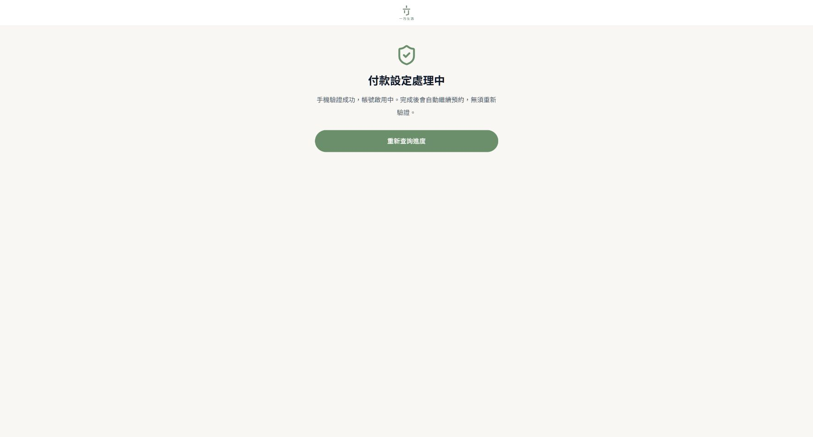
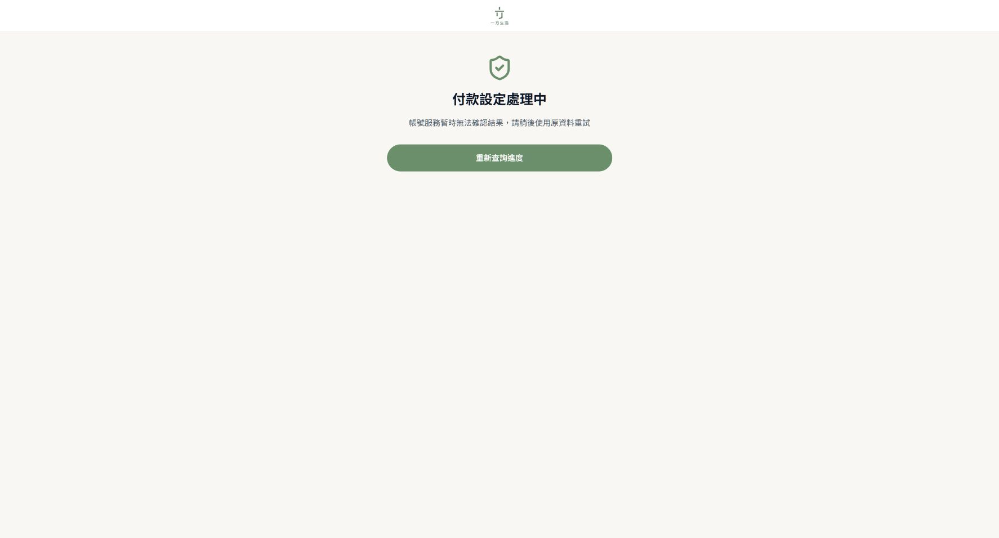
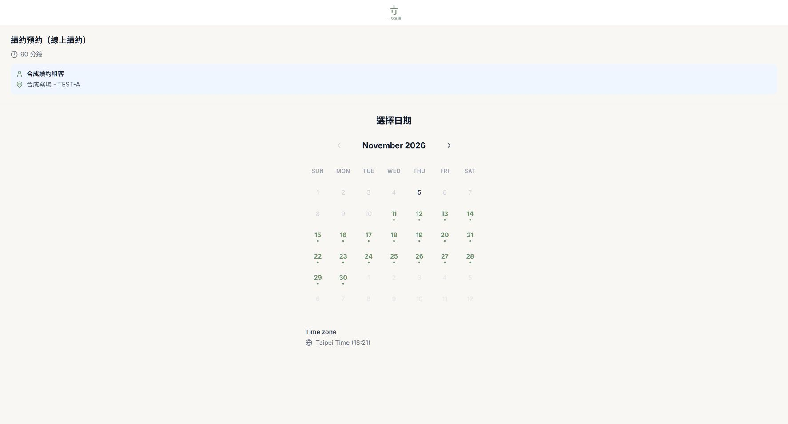
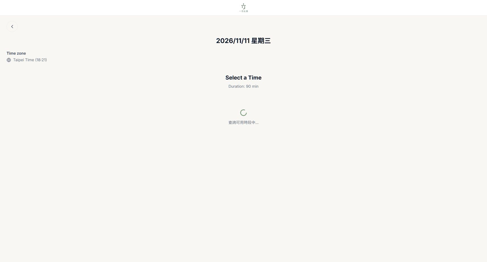

# ONE-818 續約驗證與帳號流程

[工作追蹤](https://oneplace-tw.atlassian.net/browse/ONE-818)

## 問題與改動

正式預約頁原本在 `/verify-otp` 回 `success:true`、`verifyToken` 而沒有 `virtualAccount` 時，執行 `toast.error("驗證成功")`、清空輸入並停止。新版匯訂服務 native 模式正是此回應；帳號需在收件並確認 JGB 後才會提供。

```text
手機驗證 → 保存驗證憑證 → 預約後端帶入既有租客資料 /submit
        → 保存收件憑證 → 查詢 /submissions/:id
        → pending：等待／可恢復；needs_review：請服務人員確認
        → ready：後端再驗收件手機及帳號 → 保存原有續約個資 → 回讀吻合 → 選時段
```

只修改 Booking。沿用 tenant-form-liff 原有持久待辦、帳號產生、JGB 核對及通知，不建立第二套帳號或通知流程，不改排班、續約問卷或既有預約。無 migration、無正式資料修補。保留舊 `writeRenewalVirtualAccount` 端點供既有版本相容，本次新頁面使用有 ready 憑證驗證的完成端點。

- Ragic 查詢一律 `naming=EID`，手機精確吻合、最多讀兩筆；重複租客或 UID 不符停止。
- 身分證僅在後端從既有租客主檔讀取並交給既有匯訂服務，不送到瀏覽器或 log。
- 收件以主檔原姓名、身分證、Email、職業、LINE UID 及加盟來源組成；不把未確認的編輯混入 immutable native 收件。原續約選填 Email／職業的更新仍在帳號 ready 後進行，姓名／身分證不覆寫。
- native 規定的既有資料缺漏、同帳號不同快照或 JGB 資料衝突，清楚顯示需服務人員確認；不捏造資料、不繞過新服務的核對條件，也不自動修補舊帳號。
- 瀏覽器 sessionStorage 依 LINE UID／手機隔離，保存驗證憑證或收件憑證及當次 Email／職業編輯，不保存 OTP、身分證。先保存驗證憑證才送件，取得收件後移除驗證憑證。服務以原驗證憑證去重，POST 回應中斷可安全恢復。
- pending/review 即使錯帶帳號也不釋出；ready 必須手機、收件編號與帳號格式吻合。完成時回查 Ragic，僅寫不同欄位並回讀；回應遺失後重試不重寫相同資料。
- 瀏覽器查詢進度採 POST，憑證不出現在網址；三個新端點均 no-store。後端向匯訂查詢仍用原 Bearer 收件憑證。
- 短暫查詢錯誤保留憑證並可重試；只有明確拒絕、且尚未取得收件的過期驗證可重做。已收件不得清空重新提交。

## 工作位置與版本

- Repository：`mry88312-afk/oneplace-booking`
- Branch：`codex/ONE-818-renewal-verification`
- Worktree：`C:/Projects/oneplace-booking-zeabur-worktrees/ONE-818-renewal-verification`
- 起點：`74e085e036e8215e7d18b8f589404c1a1b7c4cf6`
- 正式部署：Zeabur / ONEPLACE / oneplace-booking；原正式版本 `e68ad3e00a346435d1bbdc9595ecec1ed9071b47`。本機 API token 無此服務權限，使用已登入管理台部署；發布結果另記。
- 正式資料庫：一方生活 Supabase `dwoahbduwzfzqmwpvadj`，原 `booking`／`tenant_form` schema。此次不修改資料庫或匯訂服務。

## 驗證證據

2026-11-05 本機前後端 build 成功、型別檢查 0 錯、70/70 測試通過、0 失敗／略過；`git diff --check` 通過。全部重型工作透過 `Invoke-CodexHeavyTask.ps1`；途中 RAM 達 99% 時防護拒絕啟動一次，未繞過，先結束本工作的預覽流程。測試與建置原始紀錄保存在本工作區 `.cache/final-tests.log`、`.cache/final-build.log`。

舊版 handler 用成功的 token-only 回應實際重現錯誤訊息「驗證成功」、清空輸入且沒有下一步。新增測試涵蓋此新回應、pending 不露帳號、重新整理、斷線、失去收件回應、雙擊、保存失敗、身份不符、多筆租客、資料缺漏、錯誤遮罩、ready 授權與完成回讀。

### 實際瀏覽器（合成資料）

使用本次 production build 的前端、真實 Booking router／handler，以及 tenant-form-liff `10e349a` 對應 checkout 的原生 `createIntake`／加密與憑證邏輯。只將資料儲存、OTP、Ragic、JGB ready 狀態替換成合成環境；所有外部 fetch 被封鎖。不是單靠前端假成功。

- token-only 手機驗證 →「付款設定處理中」，沒有帳號、沒有跳時段。
- 重新整理 → 原收件繼續查詢，不重送 OTP、不新增工作。
- 模擬查詢斷線 → 保留已收件，可手動重試。
- needs_review → 顯示聯絡服務人員，不繼續預約。
- ready → 回讀儲存的 Email／職業編輯，進入日期與 90 分鐘時段頁。
- 記錄：OTP 1 次、submit 1 次、工作 1 筆、個資更新 1 次、預約寫入 0、真實外部請求 0。沒有真實簡訊、LINE、Ragic、JGB 或預約寫入。






[合成計數與回讀結果](evidence/ONE-818/remittance-preview-evidence.json)

重現入口為 `scripts/preview-renewal-remittance.ts`，需指定 tenant-form-liff main checkout、先將公開 renewal 模板回應保存 `.cache/renewal-public.json`，並以 `VITE_REMITTANCE_API_BASE=/fixture/deposit` build 至 `.cache/preview-public`。預覽只綁 `127.0.0.1:8818`，控制台 `/fixture`。正式 build 不使用此覆寫。

## 發布與回復

1. 以最新 origin/main 確認無並行差異，檢查／測試／build 通過後建立 PR；按使用者規則完成合併後再發布。
2. Zeabur 只發布此 Booking 服務，保留原變數、資料庫及其他服務。確認實際部署版本及公開 JS 中的新流程、後端新端點與登入後付款頁。
3. 正式唯讀驗證 template、原時段與新憑證檢查；不以真實租客測試送件或通知。自然 OTP → JGB → LINE 收件及人工驗收，仍須由真實自然案例補上，不以合成案例冒充。
4. 若新版錯誤，回復到相容的新版本修正或先回原 Booking 發布版本；回舊版會恢復原驗證卡住症狀，不能宣稱故障解除。保留 session 收件憑證及 tenant_form 原待辦，不重置、不重送、不將 native 切回 legacy，不清除已啟動工作。

本次無刪檔。

## 變更檔案

| 檔案 | 用途 |
| --- | --- |
| `client/src/components/booking/RemittanceView.tsx` | 驗證、進度、人工確認與繼續預約畫面 |
| `client/src/pages/BookingPublic.tsx` | 租客切換時隔離付款元件狀態 |
| `client/src/lib/remittanceFlow.ts` | 保存與恢復同一收件流程 |
| `client/src/lib/remittanceFlow.test.ts` | 重整、重試、雙擊及失敗回歸 |
| `server/booking/remittance.ts` | 原租客資料送件、憑證查詢與完成回讀 |
| `server/booking/remittance.test.ts` | 身份、資料品質、ready 與寫入驗收 |
| `server/routers/property/booking.ts` | 三個新端點及 no-store |
| `shared/remittance.ts` | 共用憑證與狀態格式 |
| `scripts/preview-renewal-remittance.ts` | 封鎖真實外部請求的畫面驗證入口 |
| `docs/ONE-818-renewal-verification.md` | 本技術與驗證紀錄 |
| `docs/evidence/ONE-818/remittance-pending.png` | 處理中畫面 |
| `docs/evidence/ONE-818/remittance-review.png` | 人工確認畫面 |
| `docs/evidence/ONE-818/remittance-ready-calendar.png` | 完成後日期頁 |
| `docs/evidence/ONE-818/remittance-ready-slots.png` | 完成後時段頁 |
| `docs/evidence/ONE-818/remittance-preview-evidence.json` | 合成流程次數及資料回讀 |
